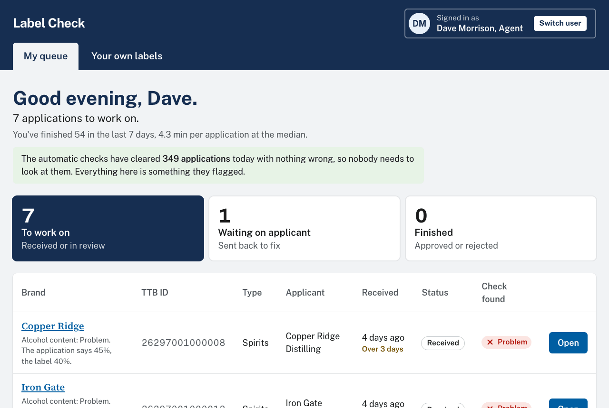
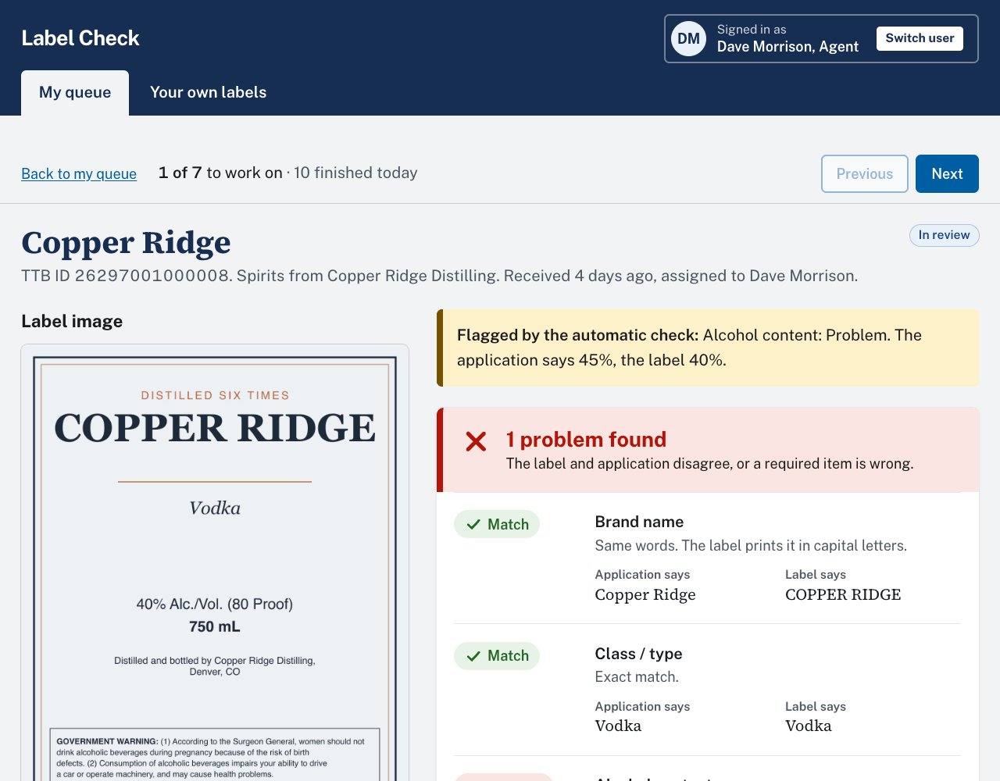
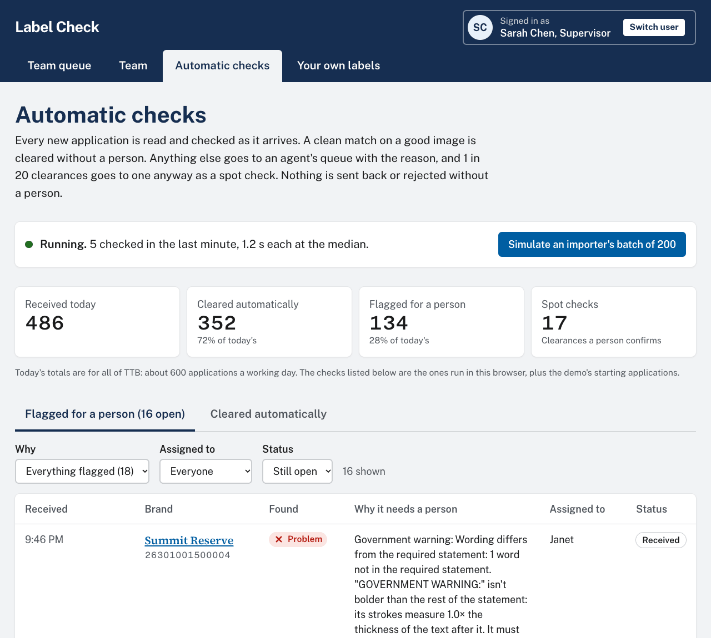
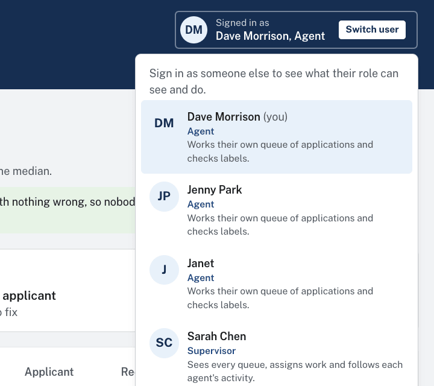
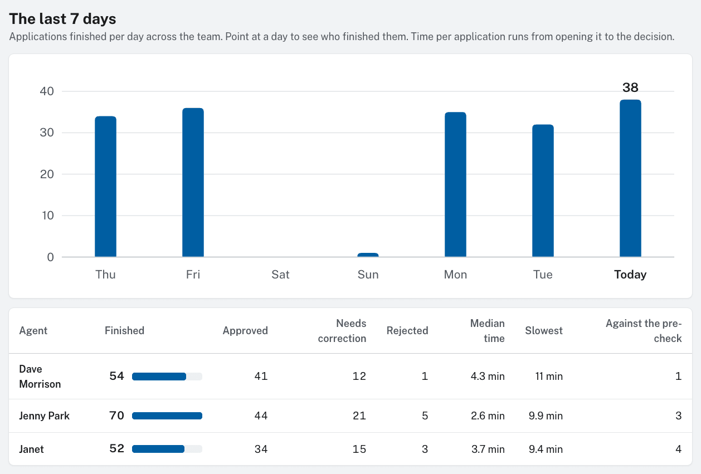
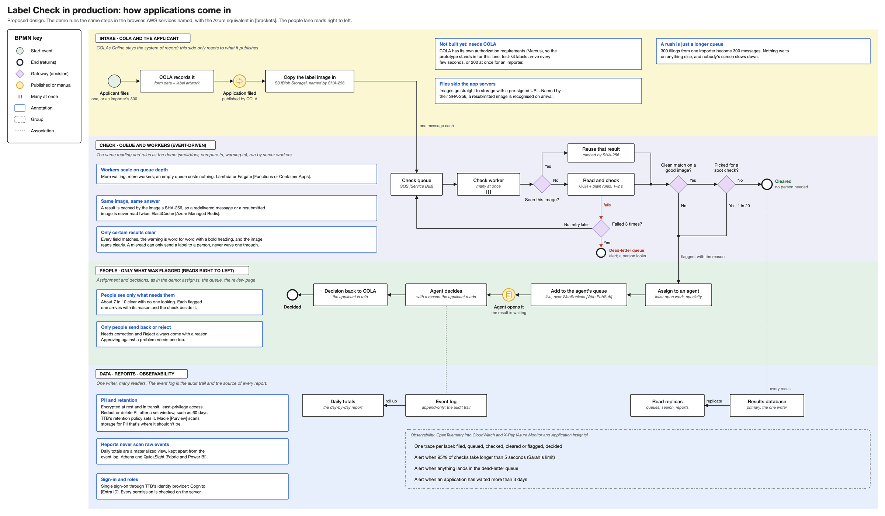

# Label Check

**Try it: [itaitakehome.vercel.app](https://itaitakehome.vercel.app).** You start as Dave, an agent. Use **Switch user** at the top right to see the supervisor and admin views. Or [download the test kit](https://itaitakehome.vercel.app/test-kit.zip): 23 fake labels with an answer key.

*I built this with an AI coding assistant. The decisions are mine, from running label validation in production on AWS.*

A prototype for TTB label compliance agents. Every new application is read and checked automatically: clean matches clear on their own, and the rest land in an agent's queue with the reason. It runs in the browser with open-source OCR, so there are no AI or cloud calls and nothing is uploaded.



| | |
|---|---|
|  |  |
| *Working one, then straight on to the next* | *Flagged kept apart from cleared* |
|  |  |
| *Each role sees and does different things* | *The supervisor's view of the week* |

## Approach

### Frontend: what runs today

- **OCR reads, plain rules decide.** Tesseract reads the label: straightened, read twice, with the warning zoomed in. Unit-tested rules compare each field and check the warning word for word. Each field ends up Match, Review or Problem, in 1–2 seconds.
- **Automatic checks.** A clean match on a good image clears without a person. Anything else goes to an agent with a one-line reason. 1 in 20 clearances is spot-checked, and nothing is sent back or rejected without a person.
- **A work queue.** Agents see only what was flagged for them, check it beside the label, record Approve, Needs correction or Reject, and go straight to the next.
- **Roles.** Agent, supervisor and system admin, with permissions the admin can change. Every action is an event: the source of the supervisor's numbers and the audit trail.
- **Locked down.** A static site whose security policy blocks requests to any other domain, for TTB's firewall.


### Backend: if this were the job

The prototype has no backend on purpose. In production I'd make it event-driven. My experience is with AWS; TTB runs on Azure, so the table gives both.



- **Event-driven.** Each COLA filing is a message. Workers scale with the queue, and failures retry, then go to a dead-letter queue.
- **Idempotent.** Results are keyed by the image's SHA-256, so nothing is read twice.
- **One writer, many readers.** Results go to one primary database; queues and reports read from replicas. Daily totals are a rollup.
- **PII.** Encrypted, least-privilege, and redacted after a set window (60 days, say), with Macie scanning for anything stored where it shouldn't be.
- **Observability.** One trace per label, with alerts when checks take over 5 seconds or anything lands in the dead-letter queue.

| Piece | AWS | Azure |
|---|---|---|
| Image storage | S3 | Blob Storage |
| Queue | SQS | Service Bus |
| Check workers | Lambda or Fargate | Functions or Container Apps |
| Database | Aurora PostgreSQL with read replicas | Azure Database for PostgreSQL with read replicas |
| Cache | ElastiCache | Azure Managed Redis |
| Finding PII | Macie | Purview |
| Monitoring | CloudWatch, X-Ray | Azure Monitor, Application Insights |
| Sign-in | Cognito | Entra ID |

## Tools used

| Tool | For |
|---|---|
| Next.js 16, React 19.3, TypeScript, Tailwind CSS 4 | The app |
| tesseract.js 7 | OCR, in Web Workers on WebAssembly |
| Papa Parse | CSV in and out |
| Vitest, headless Chrome | 95 unit tests and end-to-end runs |
| Vercel | Hosting |
| Claude Code | The AI coding assistant |

## Assumptions

- Applications arrive from COLA with their form data and label artwork. COLA isn't connected, so the demo simulates arrivals with test labels.
- The fields to check are the brief's list, and the warning is 27 CFR 16.21. A field left blank on the application isn't checked.
- About 600 applications a working day (150,000 a year), with importer batches of 200–300.
- Clearing without a person is TTB's call, so it's a setting, with spot checks and an off switch.
- Desktop browsers and English labels. Nothing sensitive is stored: the demo's data is made up and stays in the browser.

## Run it

```bash
npm install
npm run dev     # http://localhost:3000
npm test        # unit tests
npm run eval    # every test label through the real OCR, against the answer key
```

## Limitations

- Glare, curved bottles and blur lower OCR accuracy. Those go to a person rather than passing.
- Bold is measured from the pixels, so it isn't certain. Unclear cases go to Review.
- Sign-in, roles and the automatic checks are simulated in the browser.

Every rule, the test kit, measurements, trade-offs and engineering notes are in [docs/details.md](docs/details.md).
