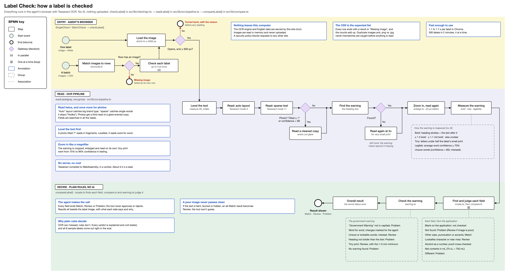
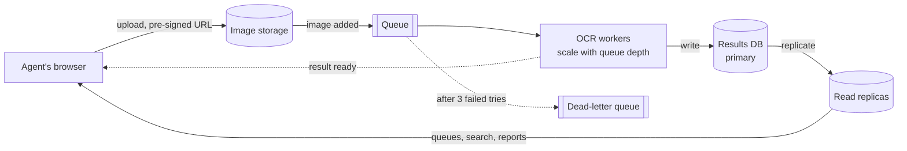

# Label Check

**Try it: [itaitakehome.vercel.app](https://itaitakehome.vercel.app).** You start signed in as Dave, an agent, with the applications the automatic checks flagged for him. Use **Switch user** at the top right to see the supervisor and admin views, including the automatic checks clearing applications live. To check a label of your own, use "Your own labels". Or [download the test kit](https://itaitakehome.vercel.app/test-kit.zip): 23 fake labels with an answer key.

*I built this with an AI coding assistant. The decisions are mine, from building and running label validation in production on AWS.*



*Top lane: what the agent does. Middle lane: how the label is read. Bottom lane, read right to left: how each field and the government warning are judged. Diamonds are decisions; blue boxes explain why.*

A prototype for TTB label compliance agents. Add a label image and what the COLA application says. The tool reads the label, compares each field, and checks the government warning word for word. New applications are checked automatically as they arrive: the clean ones clear without a person, and the rest land in an agent's queue with the reason.

Everything runs in the agent's browser with free, open-source OCR (Tesseract). There are no AI or cloud API calls, and images are never uploaded.

## Run it

```bash
npm install
npm run dev        # http://localhost:3000
npm test           # unit tests: comparison, warning, OCR image, batch, roles, assignment, metrics
npm run eval       # runs every test label through the real OCR pipeline in Node
npm run build      # static production build
```

Node 20+. `npm run dev` and `npm run build` first copy the OCR engine and English data from `node_modules` into `public/ocr/`, so the app serves them itself, and pack the test kit into `public/test-kit.zip`.

To regenerate the test labels, run `npm run samples`. For a 300-label test batch, run `npm run load-batch`; it writes to `load-test/`.

## Automatic checks, queue, roles and tracking

At 150,000 applications a year, about 600 a working day, most of what agents do is matching a form against a label. So every new application is checked as it arrives, before anyone opens it:

- **A clean match on a good image clears without a person.** Every field matches, the warning is word for word with a bold heading, and the image reads clearly.
- **Anything else goes to an agent's queue**, with the reason in one line.
- **1 in 20 clearances goes to a person anyway**, as a spot check that the automatic clearing is right.
- **Nothing is sent back or rejected without a person.** The system admin can turn automatic clearing off, or change the sample.

In the demo the checks run in your browser, standing in for the server's workers. COLA isn't connected, so arrivals are test-kit labels coming in every few seconds, and each one is really read and checked. **Automatic checks** (supervisor and admin) shows them live. **Flagged for a person** is the default view, with filters for why, who and status. Clearances have their own **Cleared automatically** tab, so success stays out of the way. A day-by-day report covers the last 14 days, with a CSV download. "Simulate an importer's batch of 200" plays out Sarah's peak-season rush.

The front page is what an agent sees after signing in: only what was flagged for them, with counts at the top and each application's reason. Opening one shows the full check beside the label. The agent records a decision using COLAs Online's names: Approve, Needs correction or Reject. Sending one back needs a reason, and so does approving one the check found a problem with. **Record and open the next one** moves straight on, and a bar at the top shows "2 of 7 to work on" and how many they've finished today.

Sign-in is simulated, so you can try each role with **Switch user**:

| Who | Role | Sees and does |
|---|---|---|
| Dave Morrison, Jenny Park, Janet | Agent | Their own queue and numbers; checks labels and batches |
| Sarah Chen | Supervisor | Every queue, reassigning work, the Team page, and the automatic checks |
| Marcus Williams | System admin | Users, roles and permissions, the automatic checks' settings, the audit log, and system health |

- **Assignment.** Flagged applications go to the agent with the least open work. An agent whose specialty matches (spirits, wine or beer) is preferred, unless they're more than 2 ahead. "Balance the queues" evens things out with as few moves as possible, and a deactivated agent's work is reassigned. (`src/lib/demo/assign.ts`)
- **Team page** (supervisor). Each agent's open work and oldest waiting application, how many they finished each day, and their median time per application. **Spot checks** list the decisions that went against the tool's check, the ones worth a second look.
- **Admin** (system admin). Change roles and specialties, deactivate users, and tick what each role can do. The last admin can't be removed. **System health** shows check times against the 5-second target, and how often an image couldn't be read.
- **Event log.** Every action is an event, and every number on those screens is computed from the log, so each one can be traced back. The log is also the audit trail, down to who opened which application.

It's all kept in this browser (localStorage), with two weeks of made-up history so the screens aren't empty. The Admin page can reset it.

"Your own labels" keeps the original tools for labels that aren't in COLA: one label typed in by hand, or a folder of images with a CSV.

## Test kit

`public/test-kit/` holds 23 fake labels, an `applications.csv` for the batch screen, and `answer-key.csv`, which says what each label should get and why. Each label tests one rule. To run it, add the `labels` folder and the CSV on the batch screen, or press **Load the test labels** there. The kit's `README.txt` lists the counts to expect.

| Files | Expected | What they test |
|---|---|---|
| 01–06 | Match | A correct label; brand in capitals vs title case; an accented import with its country; 75 cL vs 750 mL; Scotland vs United Kingdom; a tilted photo with glare |
| 07–10 | Review | Warning in tiny print; brand misspelled by one letter; bottler's city differs; an out-of-focus photo |
| 11–20 | Problem | Heading in title case; wrong alcohol; reworded warning, not bold; wrong brand; wrong net contents; proof doesn't match the percentage; heading not bold; no warning; wrong country; import with no country |
| 21 | Couldn't check | Image too small to read |
| 22–24 | Batch only | An exact copy of 01; an image with no CSV row (warning checked only); a CSV row with no image |

A full run should end with 10 problems, 4 to review, 8 matches, 1 couldn't check and 1 missing image.

## How it works

1. **Read** (`src/lib/ocr/pipeline.ts`):
   - The image is straightened: text-line angle is measured with a projection profile, then the image is rotated level.
   - Tesseract reads it twice, in "auto" and "sparse" layout modes. Each catches text the other misses: big brand names and stray single words.
   - Photos get a third read of a locally thresholded copy, which recovers text washed out by glare.
   - The government warning is then cropped, zoomed and read again, the way an agent uses a magnifier on fine print.
2. **Find** (`src/lib/locate.ts`). OCR returns lines, not fields, so the application drives the search: for each field, find what the application says should be there. Brand and class are matched with a sliding word window over the text. Alcohol and net contents are found by their number patterns. The bottler is found from "Bottled by …" plus its address line.
3. **Decide** (`src/lib/compare.ts`, `src/lib/warning.ts`). Plain, unit-tested rules make the decision. OCR only supplies the text.

Every field ends up **Match**, **Review** or **Problem**. Only an all-Match result on a good image is cleared without a person; the tool never sends back or rejects anything, so those calls stay with the agent.

| Rule | Why (from the interviews) |
|---|---|
| Case, punctuation and accents are ignored, but the result says what differed (`STONE'S THROW` vs `Stone's Throw` is a match, with a note) | Dave: "obviously the same thing" |
| Near-misses go to Review, not Problem | Agents need judgment, not a pattern matcher |
| Alcohol is compared as a number and cross-checked against proof. Net contents are converted to mL (`75 cL` = `750 mL`) | Same value, written differently |
| The warning must match 27 CFR 16.21 word for word. Differences are shown as proofreading marks (struck through = missing, highlighted = added) | Jenny: "It has to be exact" |
| `GOVERNMENT WARNING:` must be in capitals (`Government Warning` is a Problem) | Jenny's title-case rejection |
| Bold is measured from the pixels: the heading's stroke thickness against the text after it (bold measures about 1.5×, regular 1.0×). The ratio is shown to the agent | Tesseract can't see bold |
| Tiny print: warning letters under half the height of the label's other small print go to Review, along with the minimum height for that container (27 CFR 16.22: 1, 2 or 3 mm) | "Smaller font… burying it in tiny text" |
| Probable misreads (lookalike characters such as `0`/`O`, or words Tesseract itself was unsure of) go to Review, not Problem | Don't fail a good label over the tool's own reading mistake |
| A poor image never gets a clean pass | Bad photos are flagged, not guessed at |

**Batch** (`src/components/BatchCheck.tsx`, `src/lib/reconcile.ts`). Add images (files or a whole folder) and a CSV of applications, matched by file name. The CSV is the source of truth and the counts add up:
- Applications with no image appear as "Missing image" rows.
- Images with no row get the warning check only.
- Identical images under two names are flagged as duplicates.
- `label7.png` in the CSV matches `label7.jpg`.

The run itself:
- CSV problems point at row numbers.
- Images too small to read are rejected before any time is spent on them.
- Labels run in parallel, one per OCR worker (up to 4).
- A run can be stopped and resumed, and shows time remaining.
- "Show problems first" sorts the results, and the export CSV records what the label said for each field.

This reconciliation design came from production experience validating Amazon Transparency codes on printed labels: check against the expected list, and keep "couldn't read" separate from "wrong".

## Measured

On a MacBook, with the test kit:

- `npm run eval`: **every label gets the result in the answer key** (22 read, plus the too-small image turned back), 0 looser than expected, 0.7–2.7 s per label in Node. The slowest is the out-of-focus photo.
- In Chrome: 1.1–1.7 s per label for a single check, comfortably inside the 5-second limit. The whole kit finishes in 8 s on the batch screen, and all 24 rows match the answer key, whether it's loaded with the button or the unzipped folder is added by hand.
- The automatic checks keep up with an importer's batch at about 2 labels a second in Chrome, on 3 readers, leaving one free for the agent. A batch of 200 clears or routes in under 2 minutes.
- A 300-label batch (`npm run load-batch`, with a deliberately messy CSV) finishes in **2 minutes** in Chrome, about 0.4 s per label with 4 labels in parallel. Every verdict matches the test data, and reconciliation catches each planted mistake: 2 applications with no image, 2 images with no row, and 1 row naming `.png` for a `.jpg`. No request goes to any other site.

## Decisions and trade-offs

- **No AI.** The brief allowed a cloud vision model, but it costs money per label, and Marcus's firewall blocks outside ML endpoints. Tesseract runs in the browser instead. The browser loads only this site: a Content-Security-Policy (`connect-src 'self'`) blocks any third-party request, the fonts are self-hosted, and the OCR engine is served from `/ocr`. Nothing leaves the agent's computer, which also takes care of the PII concern.
- **Static site.** There's no server code, so it can be hosted anywhere, including an internal server. It's deployed on Vercel here.
- **Clear only what's certain.** Automatic clearing takes only a clean match on a good image, spot-checks a sample, and never sends back or rejects on its own. A misread only ever makes a label go to a person (the eval has 0 results looser than the answer key), so the risk is extra work, not a bad label passing.
- **Simulated sign-in.** Real accounts need a backend Marcus didn't ask for. Roles and the queue run in the browser, so a reviewer can see every role in one click.
- **Plain rules decide.** OCR is fallible; comparison rules aren't. Every verdict can be explained and is unit-tested.
- **Plain UI for every comfort level.** 18 px base text, one main button per screen, plain words, and status shown as icon + word + color. Results sit beside the label image, so agents can verify at a glance. On a phone the queue becomes cards, not a table that scrolls sideways.

## Engineering notes

**Performance**
- **Lazy loading.** The OCR engine is a dynamic `import()`, kept out of the page bundle. One worker starts loading as the page opens, so the first check doesn't wait for it.
- **Off the main thread.** OCR runs in Web Workers on WebAssembly, and each browser gets the fastest build it supports (SIMD or relaxed SIMD).
- **Bounded worker pool.** `min(4, cores − 1)` workers, since each holds a 40 MB model. Extra jobs wait in a queue.
- **Cheap image prep.** `createImageBitmap` decodes with the photo's EXIF rotation, and a canvas scales it down to 2400 px before any pixel work. Images under 600 px fail fast, before any OCR time is spent.
- **Background checks.** New arrivals are checked off the page, one every few seconds or as fast as the readers allow during a batch, with one reader always left free for the agent. They pause while the tab is hidden.
- **Prefetching.** The full result of a flagged check is kept in memory, and the next application is checked while the agent works on this one, so moving on is instant.
- **Memory and caching.** Bitmaps are closed and object URLs revoked when files are removed, so a 300-image batch doesn't pile up. The 7 MB engine is cached after the first visit.

**Security and privacy**
- **Same origin only.** The Content-Security-Policy allows requests to this site and nothing else, and no other site can frame it (`frame-ancestors 'none'`). `Referrer-Policy: no-referrer` and `nosniff` are set too.
- **No third-party requests at runtime.** `next/font` self-hosts the fonts at build time, and a build step copies the OCR engine out of `node_modules` instead of loading it from a CDN.
- **Permissions are checked twice.** The screens hide what a role can't use, and the reducer refuses it anyway, the way a server would (`blocked()` in `src/lib/demo/store.ts`).

**Code**
- **Framework-free core.** `src/lib` is plain TypeScript. The OCR pipeline takes the recognizer as a parameter (dependency injection), so the browser and the Node eval run the same code.
- **One pure reducer for the demo.** `reduce(state, action, now)` is unit-tested. The browser keeps it behind `useSyncExternalStore`, saves it to localStorage and syncs it across tabs. Components that read it render only in the browser (React 19.3's `browser()`), so there's no hydration mismatch.
- **The batch is a work queue.** A fixed pool of consumers, `AbortController` to stop, retryable vs permanent errors, and SHA-256 hashes (Web Crypto) to catch duplicate images.
- **Static all the way.** `/review?id=` rather than a route segment keeps the site static for any number of applications.
- **Rollups for volume.** Hundreds of clearances a day go into daily totals and a capped list, not the per-person event log, the way a warehouse keeps aggregates apart from raw events. Saving is write-behind, at most twice a second.

**Testing and accessibility**
- 95 unit tests (Vitest). `npm run eval` exits non-zero on any result looser than the answer key. A 300-label load test, and headless Chrome runs of every screen.
- Status is never color alone, progress is announced with `aria-live`, errors are tied to their fields, and there's a skip link.

## If this were the job

There's no backend on purpose: Marcus asked for a standalone prototype with nothing stored. As a real system, this is how I'd build it, from having built and run systems like it. My experience is with AWS, so each piece is named in AWS terms. TTB runs on Azure, so the table gives the Azure service that does the same job.



- **Event-driven batches.** A 300-label import becomes 300 messages, so a rush makes the queue longer, not the site slower. Workers scale with queue depth. A label that keeps failing lands in a dead-letter queue for a person to look at. The image's SHA-256 is the idempotency key, so a redelivered message or a re-uploaded image isn't read twice. The browser batch already works this way in miniature.
- **Clearing and assignment as consumers.** The check worker publishes "cleared" or "flagged". A flagged event runs the same rule as `assign.ts`, and each assignment is published as its own event, so the agent's queue updates live and the audit log has it.
- **Reports from rollups.** Daily totals are a materialized view over the event stream, so the day-by-day report never scans raw events.
- **One writer, many readers.** Workers write results to the primary database. Agents' queues, search and reports read from read replicas, so a big import doesn't slow anyone's screen.
- **Caching.** A CDN serves the app and the 7 MB OCR engine. Redis holds hot lookups, such as application data pulled from COLA and results by image hash, with short TTLs and no PII in the keys.
- **PII.** Encrypted at rest and in transit, least-privilege access, and an audit log of who opened what. PII is redacted or deleted after a set window, such as 60 days, by storage lifecycle rules; the real number comes from TTB's records retention policy. Amazon Macie, which finds sensitive data with machine learning and pattern matching, scans storage for PII that ended up where it shouldn't be.
- **Accounts.** Single sign-on through TTB's identity provider, with the roles above enforced on the server.
- **Tracking and observability**, kept as two separate things:
  - *Work tracking* is the append-only event log, as in the demo. Supervisors see the team's numbers and agents see their own. Operator data is employee data, so it's access-controlled like everything else.
  - *System telemetry* is OpenTelemetry: one trace per label from upload through the queue and worker to the result, plus structured logs and metrics.
  - *Alerts* come from the interviews: 95% of checks under 5 seconds (Sarah's limit), anything in the dead-letter queue, and any application waiting past target.

| Piece | AWS | Azure |
|---|---|---|
| Image storage, deleted after N days | S3 with lifecycle rules | Blob Storage lifecycle management |
| Events and queue | S3 event notifications, SQS with a dead-letter queue | Event Grid, Service Bus |
| OCR workers | Lambda, or ECS on Fargate | Azure Functions, or Container Apps |
| Results database | Aurora PostgreSQL with read replicas | Azure Database for PostgreSQL with read replicas |
| Cache and CDN | ElastiCache, CloudFront | Azure Managed Redis, Front Door |
| Live updates | API Gateway WebSockets | Web PubSub |
| Finding PII | Macie | Microsoft Purview |
| Keys and audit | KMS, CloudTrail | Key Vault, Azure Monitor activity logs |
| Monitoring | CloudWatch, X-Ray | Azure Monitor, Application Insights |
| Daily reports | Athena, QuickSight | Microsoft Fabric, Power BI |
| Sign-in | Cognito, federated to the agency's identity provider | Microsoft Entra ID |
| FedRAMP hosting | GovCloud (US) | Azure Government |

## Limitations

- Glare, curved bottles and blurry photos lower OCR accuracy. The tool sends these to Review rather than passing them, but it can't read what isn't legible.
- A slightly blurry photo can still read as clear and misread a word (`10` for `to`), which shows as a Problem. That errs on the strict side: the agent looks, and nothing wrong gets through.
- Bold detection is a measurement, not a certainty. Unclear cases go to Review.
- Physical type size (mm) can't be measured from a photo, which has no scale. Only relative size is flagged.
- The first visit downloads about 7 MB of OCR engine and data; later visits use the cached copy.
- HEIC photos open only in Safari. English labels only.
- The automatic checks run in the browser tab here, so they stop when it's closed; in production they're server workers. Arrivals reuse the test kit's labels.
- Sign-in, roles and the queue are simulated in this browser. There's no real authentication, COLA integration or server-side audit trail; see [If this were the job](#if-this-were-the-job).
- One set of rules for every beverage. Wine and beer exceptions, such as beers that needn't show alcohol content, are handled only by leaving that field blank on the application.

## Next steps

- An optional vision model hosted inside TTB's Azure tenant, if budget allows, for curved and glare-heavy photos.
- Integration with COLA, to pull application data and send "Needs correction" reasons to the applicant.
- Rule sets per beverage type.

## Layout

```
src/lib/ocr/        image processing, the reading pipeline, Tesseract output conversion
src/lib/locate.ts   finds each field in the OCR text
src/lib/compare.ts  field comparison rules
src/lib/warning.ts  government warning rules
src/lib/csv.ts, reconcile.ts   batch CSV parsing and reconciliation
src/lib/demo/       the demo: users and roles, seed data, assignment, metrics, the reducer
src/lib/client/     browser-only: OCR worker pool, image loading, the automatic checks, the demo's storage
src/app/            routes: / (queue), /review, /automation, /team, /admin, /check and /batch (your own labels)
src/components/     the screens and the results view
scripts/            test kit generation and zip, eval, load batch, OCR asset copy
```
